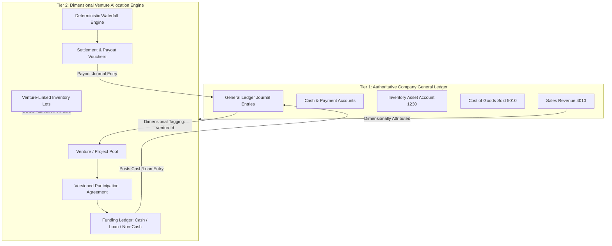

# AFK THEORY Business OS — Venture Engine & Customisation Architecture Blueprint

**Module:** Ventures, Projects & Flexible Investment Engine  
**Version:** 2.0.0  
**Target Environment:** Local-First Windows 11 / Docker Compose / PostgreSQL 16 / Next.js 15 App Router / Drizzle ORM  
**Date:** 2026-10-23  

---

## 1. Executive Summary & Business Context

AFK THEORY has five founding partners (**Shawon, Rafi, Tousif, Midhat, Mueid**) with 20% baseline legal equity in the parent company. 

Real-world commercial growth, however, demands **project-by-project agility**:
- **Unequal Funding:** A T-shirt drop requires ৳100,000 where 3 partners contribute in varying proportions while 2 opt out.
- **Asymmetric Profit Sharing:** An investor contributes 50% capital but negotiated 40% profit share due to another partner providing sweat equity (design/production).
- **Non-Cash Contributions:** Fabric contributions, personal supplier payments, and creative direction valued with independent approval.
- **Batch-Level Funding:** Batch 001 of a hoodie is funded by Partner A & B; Batch 002 is funded by Partner C, D & an external investor.
- **Loss Protections & Waterfalls:** Contractual loss carryforwards, preferred returns, and capital recovery before profit distributions.
- **No Inadvertent Dilution:** Project-level profits or losses **never** alter the parent company's 20% equity ledger unless explicitly ratified at the corporate governance level.

---

## 2. Core Architecture & Architectural Invariants

### 2.1 The Two-Tier Ledger Model
1. **Tier 1 — Authoritative Statutory General Ledger:** The single source of truth for double-entry accounting (Cash, Receivables, Inventory Assets, COGS, Accounts Payable, Capital).
2. **Tier 2 — Contractual Venture Allocation Ledger:** Dimensional attribution of transactions (`ventureId`, `lotId`, `participantId`) that governs economic entitlement, capital recovery, and settlement payouts without duplicating company expenses.



### 2.2 Mathematical & Business Invariants
1. **100.00% Distribution Invariant:** Active profit-sharing percentages and loss-sharing percentages across active participants must equal exactly $100.00\%$.
2. **Independence of Metrics:** Investment %, Profit %, Loss %, Capital Recovery Priority, and Voting Rights are strictly segregated fields.
3. **No Phantom Money:** Transfers between internal accounts and partner loan contributions are never treated as sales revenue.
4. **Deterministic Decimal Math:** All financial calculations use integer-paisa or exact two-decimal decimal arithmetic with documented remainder allocation to the last qualifying participant.
5. **No Negative Cash Distributions:** Cash payouts can never exceed available realized distributable cash. Unsold inventory is reported as asset valuation, not realized profit.
6. **Immutable Agreement Snapshots:** Every posted settlement permanently stores the agreement version ID and mathematical calculation snapshot. Historical records are never silently altered.

---

## 3. Relational Data Model (Normalized Drizzle Entities)

### 3.1 Venture Core & Governance
- `ventures`: Core entity (`id`, `ventureNumber` e.g. `VENT-2026-0001`, `title`, `typeCode`, `stage`, `budget`, `startDate`, `targetDate`, `managerUserId`, `createdAt`).
- `venture_types`: Configurable categories (Product Drop, Collection, Independent Venture, Marketing Campaign, Collaborative Project).
- `venture_agreements`: Versioned investment agreements (`id`, `ventureId`, `version`, `status`, `participationMode`, `effectiveDate`, `waterfallRules`, `isLocked`).
- `venture_participants`: Individual terms (`id`, `agreementId`, `participantType`, `partnerId`, `contactId`, `role`, `investmentCommitment`, `investmentPercentage`, `profitSharingPercentage`, `lossSharingPercentage`, `capitalRecoveryPriority`, `status`).

### 3.2 Funding & Capital Ledger
- `venture_contributions`: Actual funding events (`id`, `ventureId`, `participantId`, `contributionType` [CASH, PARTNER_LOAN, NON_CASH_ASSET, SERVICE], `amount`, `valuationBasis`, `paymentAccountId`, `journalEntryId`, `status`, `approvedByUserId`).
- `venture_cost_allocations`: Attribution of direct or shared overhead expenses (`id`, `ventureId`, `journalEntryId`, `amount`, `allocationBasis` [DIRECT, PERCENTAGE, REVENUE_PROPORTIONAL, UNITS_SOLD], `memo`).

### 3.3 Product & Inventory Links
- `venture_product_links`: Association between ventures and products/collections (`id`, `ventureId`, `productId`, `collectionId`, `notes`).
- Dimensional foreign key on `inventory_lots.venture_id`: Ties finished goods lots and raw materials to specific venture funding agreements.
- Dimensional foreign key on `production_orders.venture_id`: Ties cut-make-trim manufacturing batches to specific ventures.
- Dimensional foreign key on `sales_lines.venture_id`: Direct attribution of sales revenue and COGS.

### 3.4 Allocation & Settlement Engine
- `venture_allocation_snapshots`: Immutable audit record of profit/loss calculations (`id`, `ventureId`, `agreementVersionId`, `periodStart`, `periodEnd`, `revenueRecognized`, `cogsRecognized`, `expensesAttributed`, `netProfitOrLoss`, `calculatedAllocationsJson`, `createdAt`).
- `venture_settlements`: Authorised payouts or reinvestments (`id`, `settlementNumber`, `ventureId`, `snapshotId`, `settlementType` [FULL, PARTIAL, PROFIT_ONLY, CAPITAL_RECOVERY, REINVESTMENT], `totalAmount`, `paymentAccountId`, `journalEntryId`, `status`, `approvedByUserId`).
- `venture_settlement_lines`: Recipient details (`id`, `settlementId`, `participantId`, `amount`, `payoutType`, `taxDeducted`, `netPaid`).

### 3.5 Business Customisation Studio
- `custom_field_definitions`: User-created attributes (`id`, `entityType` [VENTURE, PRODUCT, SUPPLIER, ORDER, PARTNER], `fieldKey`, `fieldLabel`, `dataType` [TEXT, NUMBER, MONEY, PERCENTAGE, DATE, SELECT, CHECKBOX], `options`, `isRequired`, `isPublic`).
- `custom_field_values`: Entity-linked values (`id`, `definitionId`, `entityId`, `valueText`, `valueNumeric`, `valueDate`, `valueJson`).
- `workflow_definitions`: Dynamic approval workflows (`id`, `workflowType`, `name`, `stagesJson`, `isActive`).

---

## 4. Participation Modes & Waterfall Logic

1. **Mode 1 — Equal Investment & Equal Profit:** All selected participants commit equal capital and receive equal profit ($1/N$).
2. **Mode 2 — Investment-Proportional:** Profit % equals Contribution %.
3. **Mode 3 — Custom Profit Sharing:** Independent investment % and profit-sharing % (e.g., 50/30/20 funding vs 40/40/20 profit).
4. **Mode 4 — Fixed Priority Return + Residual:** Contractual fixed preferred hurdle rate followed by residual split.
5. **Mode 5 — Capital Recovery First:** Realized net cash returns 100% of contributed capital before any profit is recognized or distributed.
6. **Mode 6 — Profit Reinvestment:** Distributable profits rollover into subsequent venture/production batches.
7. **Mode 7 — Service / Management Sweat Equity:** Approved percentage entitlement without mandatory cash capital injection.
8. **Mode 8 — Multi-Stage Waterfall Engine:** Structured sequential rules:
   - Stage 1: Retained Operational Reserve (e.g., 10% held for returns/contingency).
   - Stage 2: Qualifying Capital Recovery (pro-rata or priority rank).
   - Stage 3: Preferred Return / Priority Dividend.
   - Stage 4: Agreed Residual Profit Split.

---

## 5. Screen Map & User Experience

```text
/ventures                         — Ventures Directory & KPI Dashboard
/ventures/new                     — 10-Step Interactive Venture & Agreement Wizard
/ventures/[id]                    — Venture Central Dashboard (Lifecycle, Performance, Financials)
/ventures/[id]/agreements         — Agreement Builder & Versioned Amendments
/ventures/[id]/funding            — Funding Ledger, Commitments & Non-Cash Valuation
/ventures/[id]/expenses           — Direct Expenses & Overhead Allocation
/ventures/[id]/production         — Linked Collections, Production Orders & Lots
/ventures/[id]/sales              — Revenue, Lot-Level COGS & Real-Time Gross Margin
/ventures/[id]/allocations        — P&L Waterfall Simulator & Settlement Preview
/ventures/[id]/settlements        — Executed Distributions, Reinvestments & Payout Vouchers
/ventures/[id]/documents          — Agreement Contracts, Term Sheets & Signed Proofs
/ventures/[id]/audit              — Immutable Version History & Audit Trail
/studio                           — Business Customisation Studio (Custom Fields, Categories, Workflows)
```

---

## 6. Implementation Phasing & Delivery Roadmap

- **Phase A:** Normalized Database Schema, Foreign Keys & Versioned Drizzle Migrations.
- **Phase B:** Venture Service Layer & 10-Step Interactive Agreement Wizard.
- **Phase C:** Funding Ledger, Capital Tracking & GL Transactional Integration.
- **Phase D:** Deterministic Allocation & Multi-Tier Settlement Engine.
- **Phase E:** Production, Batch & Lot-Level Profitability Integration.
- **Phase F:** Business Customisation Studio & Custom Fields Engine.
- **Phase G:** Analytics, Reporting & Printable Agreement / Settlement Vouchers.
- **Phase H:** Acceptance Test Suite (25 Tests) & Local Production Verification.
