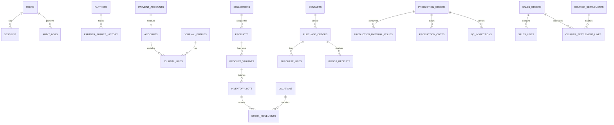

# AFK THEORY Business OS — Relational Database Schema Specification

**Database Engine:** PostgreSQL 16  
**ORM:** Drizzle ORM (TypeScript) with versioned migrations  
**Design Principles:** Foreign keys, non-null constraints, unique business references, atomic ledger invariants, immutable posted journals with traceable reversals, explicit user auditing.

---

## 1. Schema Architecture & Module Grouping

The relational model organizes tables into seven domain schemas/groups:
1. **Core & Governance (`auth_`, `governance_`)**: Users, sessions, roles, permissions, partners, ownership history, audit trail.
2. **General Ledger (`gl_`)**: Fiscal periods, chart of accounts, journal entries, journal lines, payment accounts, reconciliations.
3. **Catalog & Inventory (`inv_`)**: Drops/collections, products, variants (SKUs), locations, inventory lots, stock movement ledger, BOMs.
4. **Procurement (`proc_`)**: Contacts (suppliers, couriers, customers), purchase orders, goods receipt notes (GRN), supplier bills.
5. **Manufacturing (`mfg_`)**: Production orders (Routes 1, 2, 3), material issues, direct production costs, QC inspections.
6. **Sales & Courier (`sales_`)**: Customers, sales orders, order items, courier shipments, COD remittance settlements, returns/RMAs.
7. **Work & Documents (`sys_`)**: Ideas, tasks, local documents/attachments, settings, backup logs.

---

## 2. Invariants & Concurrency Constraints

- **Debit-Credit Balance Constraint:** Journal entries in status `POSTED` must have sum(debit) == sum(credit).
- **No Negative Inventory Without Override:** Outgoing stock movements cannot reduce available physical stock below zero.
- **Concurrent Stock Locking:** Allocation of remaining SKU lots executes with row-level locks (`SELECT ... FOR UPDATE`) inside an explicit transaction.
- **Traceable Reversals:** Modifying a posted journal is prohibited; a correcting journal references the original via `reversal_of_id`.
- **Unique Business Numbers:** Human-readable sequential references (`AFK-INV-2026-0001`, `AFK-PO-2026-0001`, `LOT-2026-001`, etc.) enforced by unique database indexes.

---

## 3. Entity Relationship Summary

